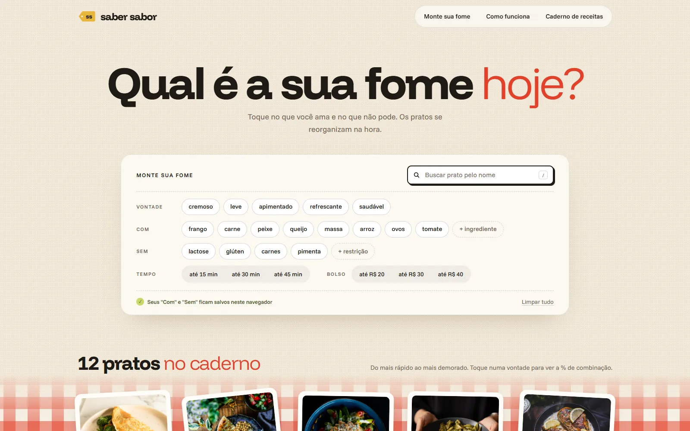
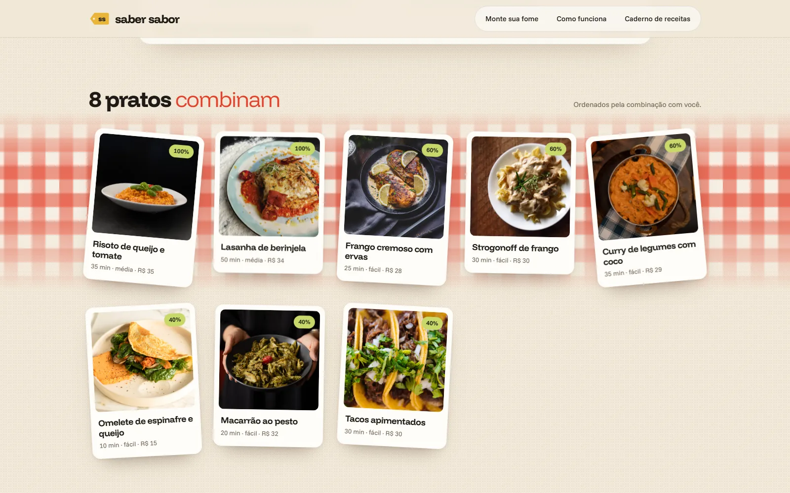
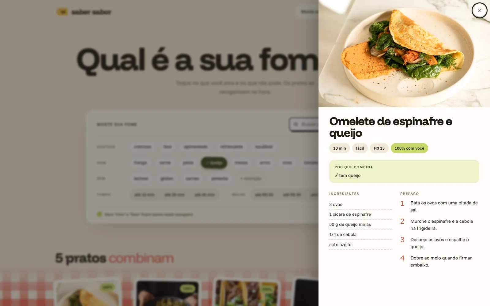

# Saber Sabor

Um sistema de busca de comidas de acordo com as preferências do usuário: um recomendador de receitas fáceis com cara de feira. Você monta a sua fome em chips (vontade, ingredientes, restrições, tempo e bolso) e os pratos se reorganizam na hora.



## O que dá para fazer

- **Montar a sua fome** com chips de Vontade, Com, Sem, Tempo e Bolso, ou buscar um prato pelo nome.
- **Ver os pratos que combinam**, cada um com a porcentagem de combinação, reorganizados a cada chip.
- **Abrir a receita** numa gaveta lateral: tempo, dificuldade, preço, por que combina, ingredientes e preparo.
- **Usar o caderno de receitas:** filtros rápidos, nova receita por formulário, remover com desfazer e restaurar o caderno original. O caderno fica salvo no navegador.

| Pratos que combinam | Receita aberta |
|---|---|
|  |  |

## Como abrir

Abra o `index.html` no navegador. É um site estático: não precisa de servidor nem de instalação.

## Testes

São 23 testes automatizados do motor de recomendação e do armazenamento:

```bash
node --test testes/*.test.js
```

Pede o Node 20 ou mais novo.

## Tecnologias

HTML, CSS e JavaScript puro, com GSAP nas animações. Fontes Funnel Display e Funnel Sans. As fotos são do Unsplash.

## Estrutura

- `index.html`: a página.
- `css/`: tokens, base, componentes e seções.
- `js/motor.js`: a recomendação. `js/dados.js`: as receitas. `js/armazenamento.js`: o caderno salvo no navegador.
- `js/ui/`: painel de chips, resultados, busca, gaveta, caderno, faixa, aviso e movimento.
- `testes/`: os testes, com o `node:test`.
- `docs/`: a especificação do redesign.

## Sobre

Redesign do Saber Sabor original, que também fiz. A direção é "Feira": papel, cards inclinados, chips e toalha xadrez. Identidade visual, UX e código: **Washington Gabriel** ([GitHub](https://github.com/Washington-dev-fullstack)).
